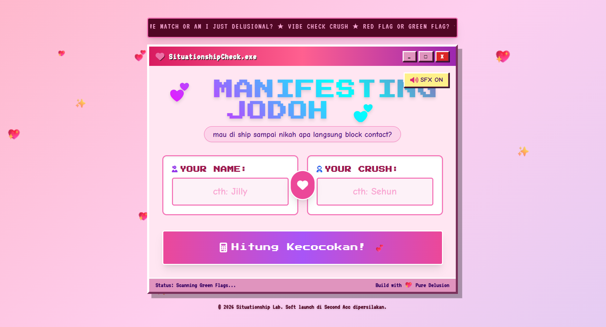
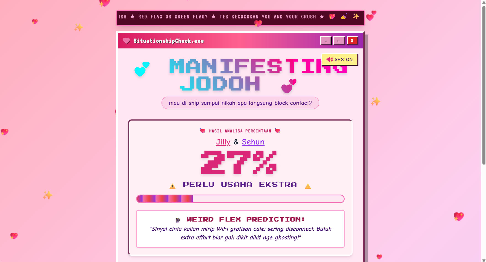
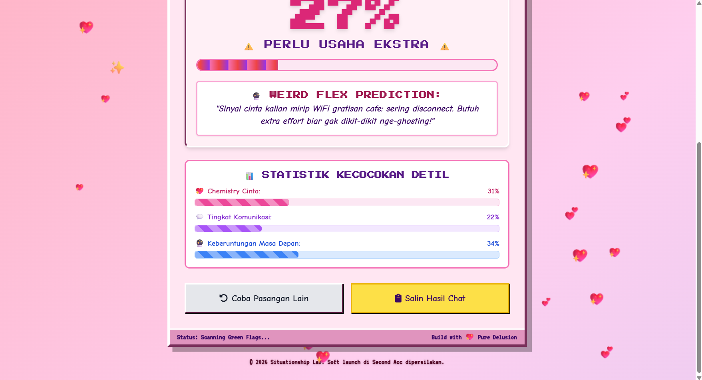

# Love Calculator (Situationship Check)💗🧮
# 💖 SITUATIONSHIP CHECK: Love Compatibility & Vibe Check Meter

> **"Kalkulator Kecocokan Cinta & Vibe Check Retro Y2K dengan Algoritma Deterministik dan Sound Effects Synthesizer!"**

---

## 📌 1. Definisi Aplikasi

**SITUATIONSHIP CHECK** adalah sebuah aplikasi web interaktif berbasis *Client-Side* yang mengadaptasi estetika antarmuka **Y2K / Windows Retro 2000-an** (Windows 98 Pink Edition). 

Aplikasi ini dirancang untuk menghitung tingkat kecocokan percintaan antara dua nama, menghasilkan persentase kecocokan, *breakdown stats* (Chemistry, Komunikasi, Keberuntungan), serta ramalan unik secara instan tanpa memerlukan koneksi ke server backend.

---

## ✨ 2. Fitur Utama

1. **🎨 Y2K & Neo-Brutalist Visual Design:**
   * Tampilan khas sistem operasi retro (Windows 98/2000 style), teks berjalan (*marquee*), warna *cyber-pink*, font pixel/retro, serta efek partikel hati/glitter yang melayang.
2. **🧠 Algoritma Hashing Deterministik (Anti-Random Repetitif):**
   * Menggunakan kalkulasi *character hash code* sederhana pada pasangan nama. Jika nama **A** dan nama **B** dimasukkan berkali-kali, hasilnya akan selalu **konsisten (tetap sama)**.
3. **🎵 Retro Web Audio Synthesizer (SFX Tanpa File MP3):**
   * Memanfaatkan **Web Audio API** bawaan browser untuk menghasilkan efek suara *beeping* retro, *drumroll* kalkulasi, dan *chimes victory fanfare* secara real-time tanpa membutuhkan file audio eksternal. Dilengkapi tombol *Mute/Unmute toggle*.
4. **📊 Breakdown Stats & Dynamic Verdict:**
   * Menampilkan statistik detail kecocokan meliputi **Chemistry**, **Komunikasi**, dan **Keberuntungan Masa Depan**.
   * Menghasilkan vonis ramalan unik dan saran prediksi.
5. **📲 Fitur Bagikan Hasil (Share Result):**
   * Tombol satu-klik untuk menyalin ringkasan hasil kalkulasi ke *clipboard* agar mudah dibagikan ke media sosial atau aplikasi *chatting*.
6. **📱 Fully Responsive & Fast Loading:**
   * Dibuat menggunakan HTML5, Tailwind CSS, dan Vanilla JavaScript dalam 1 file tunggal (`index.html`) yang ringan dan dapat dibuka di Smartphone maupun PC/Laptop.

---

## 🛠️ 3. Teknologi Perancangan (Tech Stack)

* **Front-End Framework / Styling:** Tailwind CSS v3 (via CDN) & Custom CSS Keyframe Animations.
* **Typography & Fonts:** Google Fonts (`Press Start 2P`, `VT323`, `Comic Neue`, `Fredoka`).
* **Programming Language:** Vanilla JavaScript (ES6+).
* **Audio Engine:** Web Audio API (`AudioContext`).
* **Deployment & Storage:** 100% Client-Side / Standalone Static File (Bisa dijalankan langsung di browser atau dideploy di GitHub Pages / Netlify / Vercel).

---

## 📂 4. Dokumentasi

